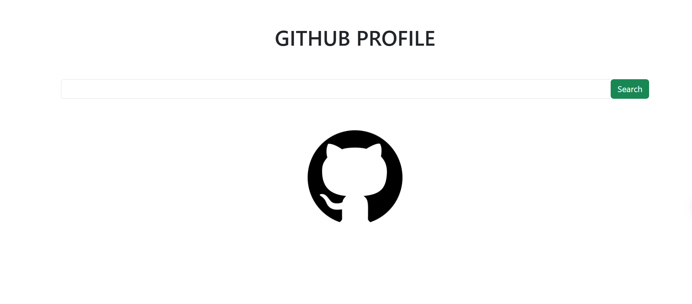

# GitHub Profile
**[Acessar site](https://react-github-profile.vercel.app/)**


Mini-site desenvolvido durante uma aula prática de React, com o objetivo de aprender os fundamentos da biblioteca e consumir a API pública do GitHub.

A aplicação permite pesquisar um usuário pelo nome de usuário e visualizar informações públicas do seu perfil, como foto, nome, localização e links disponíveis.

## Demonstração

### Versão Web



### Versão Mobile


## Tecnologias utilizadas

- **React** 
- **JavaScript** 
- **CSS** 
- **Bootstrap** 
- **GitHub REST API** 

## Conceitos praticados

- Componentes funcionais em React.
- Gerenciamento de estado com o hook `useState`.
- Manipulação de eventos com `onSubmit` e `onChange`.
- Requisições HTTP utilizando `fetch`.
- Consumo e exibição de dados de uma API.
- Renderização condicional de componentes.

## Implantação

Front end: Vercel

## Como executar o projeto

Pré-requisitos: Node.js e npm instalados.

1. Clone o repositório:

   ```bash
   git clone https://github.com/guilhermenoe2020-netizen/react-github-profile.git
   ```

2. Acesse a pasta do projeto:

   ```bash
   cd react-github-profile
   ```

3. Instale as dependências:

   ```bash
   npm install
   ```

4. Inicie a aplicação:

   ```bash
   npm start
   ```

5. Acesse [http://localhost:3000](http://localhost:3000).

## Agradecimentos

Agradeço à **DevSuperior** pelo conteúdo didático disponibilizado, que serviu de base para a prática e para o desenvolvimento deste projeto.

- [Conteúdo de referência:](https://youtu.be/IOJoJGDowEY)
